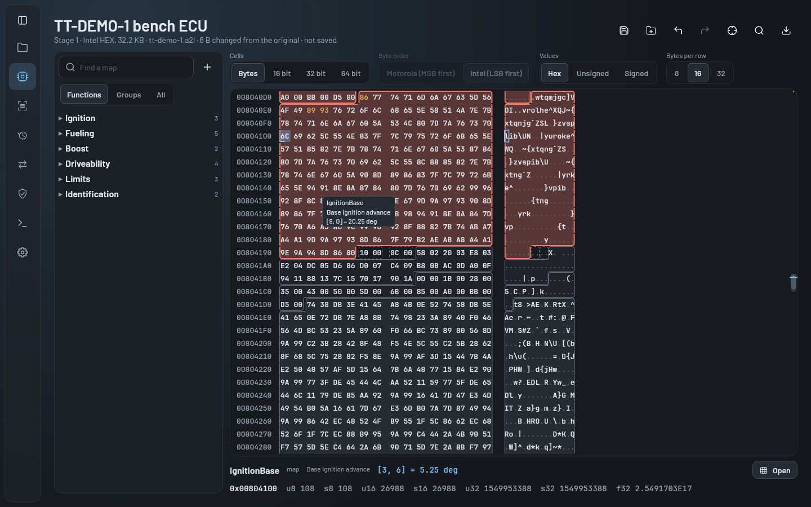
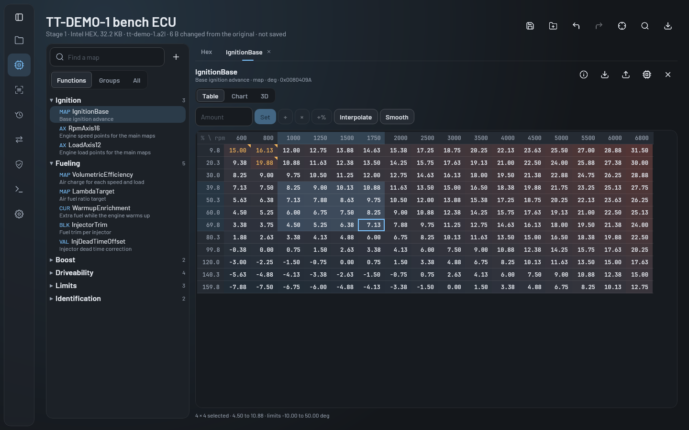
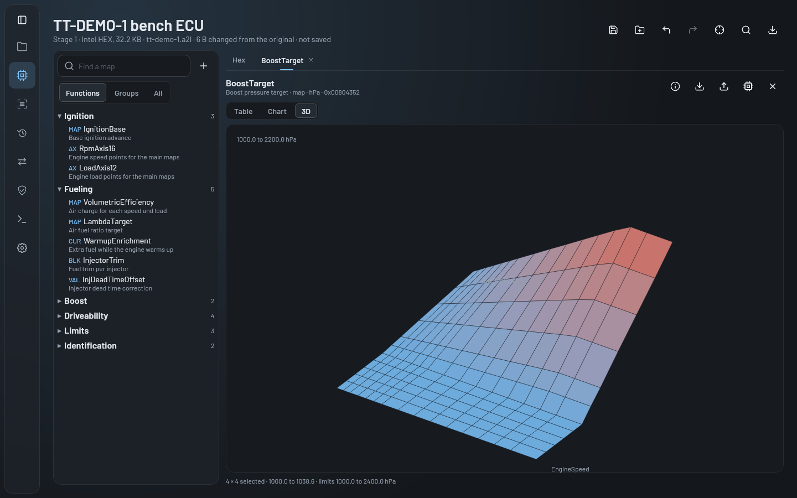
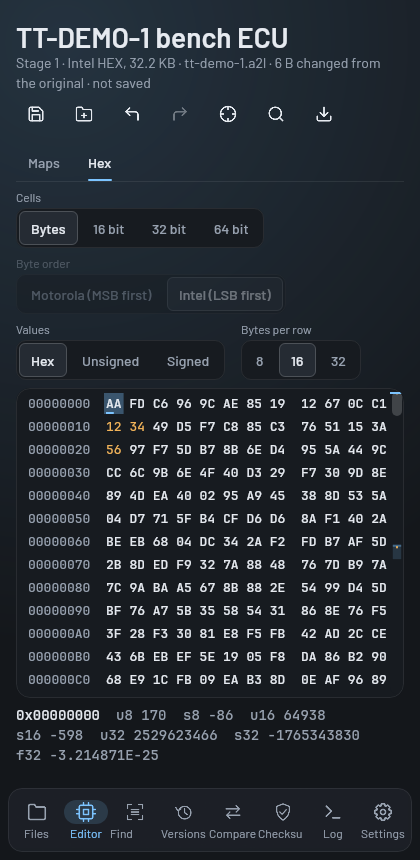
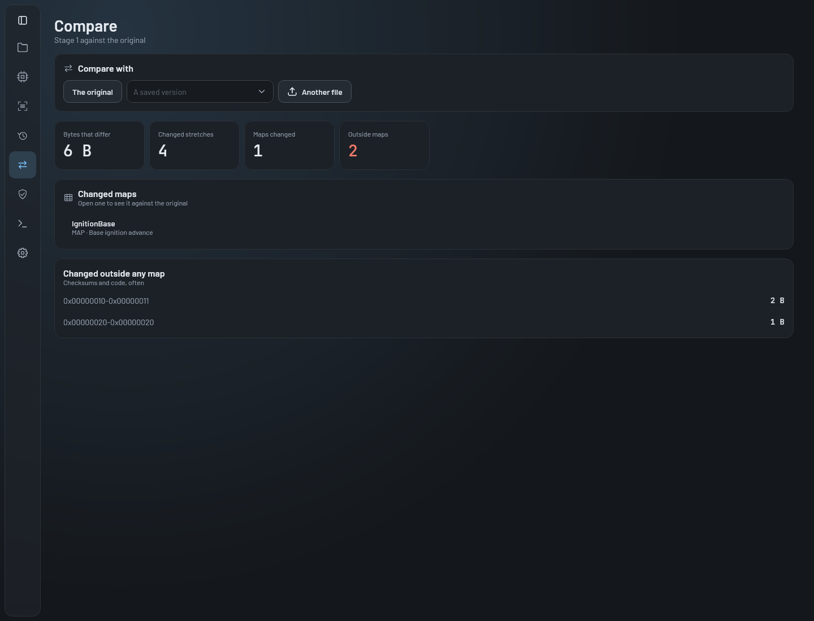
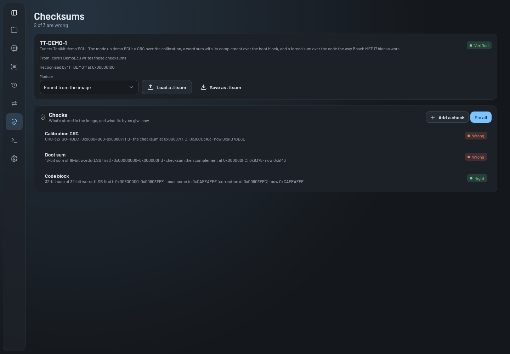
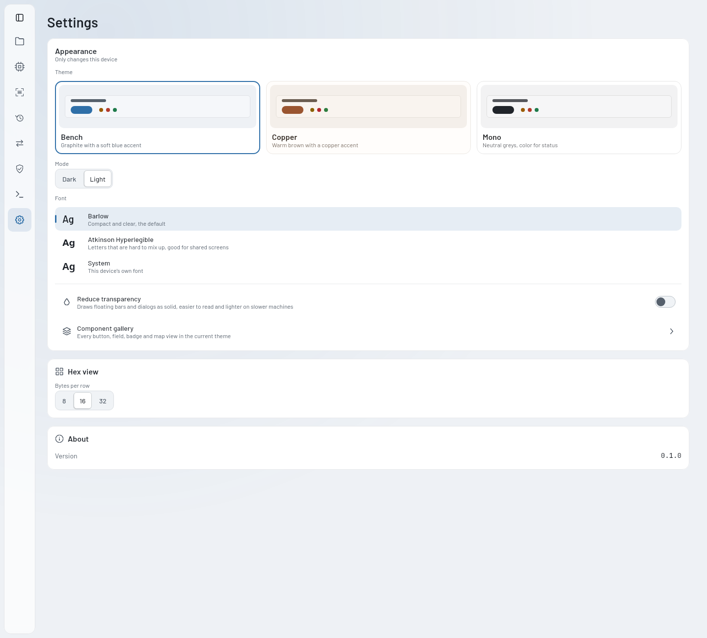

# Tuners Toolkit

A free, open source ECU calibration editor for desktop, Android and the web. Open a firmware image and its
description (an ASAM `.a2l`, a TunerPro `.xdf`, or a definition you made in the app). Then browse the maps, edit them
as a table, a chart or a 3D surface, compare against the original, fix the checksums and export the result.



**Try it in your browser:** [mr0btain.github.io/TunersToolkit](https://mr0btain.github.io/TunersToolkit/). It runs
entirely on your machine, and files never leave the browser. You can also download it from
[Releases](https://github.com/Mr0btain/TunersToolkit/releases).

## What it does

- **Opens images**: Intel HEX, Motorola S-record and raw binaries, recognised by their content rather than the file
  extension. A broken record is reported with its line, and the rest still loads.
- **Reads definitions**: A2L (ASAM MCD-2 MC, every characteristic kind from VALUE to CUBE_5, record layouts, shared
  and fixed axes, every conversion including FORM formulas), TunerPro XDF, and its own `.ttdef`. The EPK is checked
  against the image, and anything that couldn't be read is listed with the reason.
- **Hex editor**: smooth scrolling over any size of image, with the definition's maps tinted and outlined in the bytes.
  It has typed values under the cursor, find, go to, copy and paste as hex or text, and undo and redo.
- **Map editor**: a table with low to high tints and changed cells marked, a 2D chart and a 3D surface. Set, add,
  multiply, add %, interpolate and smooth over a selection. Paste from a spreadsheet. Edits are kept within the map's
  limits.
- **Projects and versions**: the original read is kept untouched, and every saved version sits on a timeline. You
  can open, compare, rename or branch any of them.
- **Compare**: the image against its original, a saved version or another file. It shows which maps changed and by
  how much, and what changed outside any map, and you can copy a map across.
- **Find maps**: with no definition, it suggests likely maps and axes in the image, and you can add them as maps of
  your own.
- **Checksums**: built-in modules recognise their ECU family, check every checksum and fix them all in one step.
  You can add checks of your own (sums, XOR, CRCs, Adler-32 and forced correction words), keep them as a module for
  every image, and share them as `.ttsum` files. See [docs/checksums.md](docs/checksums.md).
- **Exchange**: calibration values in and out as DCM, CDFX (and PaCo in), a map as CSV, the map list as CSV, and the
  definition as `.ttdef` or XDF.
- **ECU identification**: hardware and software numbers, part numbers, calibration IDs and VINs found in the image's
  text.

| | | |
|---|---|---|
|  |  |  |
|  |  |  |

## Supported formats

| Format | Read | Write | Notes |
|---|---|---|---|
| Intel HEX | ✅ | ✅ | Record types 00 to 05 |
| Motorola S-record | ✅ | ✅ | S0 to S9 (S19, S28, S37) |
| Raw binary | ✅ | ✅ | You give the base address; gaps are filled with 0xFF when written |
| ASAM A2L | ✅ | ✅ | MCD-2 MC 1.5.1 to 1.7.1, with A2ML and IF_DATA kept as written. The app doesn't open `/include`d files yet: they're skipped with a warning |
| TunerPro XDF | ✅ | ✅ | Tables, constants, axes and math |
| `.ttdef` | ✅ | ✅ | Tuners Toolkit's own definition, for maps made in the app |
| DCM (DAMOS) | ✅ | ✅ | Values by name |
| ASAM CDF / CDFX | ✅ | ✅ | Values by name |
| ETAS PaCo | ✅ | | Values by name |
| CSV | ✅ | ✅ | One map, or the map list |
| `.ttsum` | ✅ | ✅ | Checksum modules |

[docs/formats.md](docs/formats.md) has the details and the specifications each one follows.

## Building and running

You need a JDK (Gradle fetches JDK 21 itself if it isn't installed) and `git`. The first build clones the shared UI
kit and logger next to the project, under `.deps/`.

```bash
./gradlew :composeApp:run                              # the desktop app
./gradlew :composeApp:wasmJsBrowserDevelopmentRun      # the web app, in a browser
./gradlew :androidApp:assembleDebug                    # an Android APK
./gradlew :composeApp:packageDistributionForCurrentOS  # an installer for this OS (DMG, MSI or DEB)

./gradlew :core:jvmTest :composeApp:desktopTest        # the tests
```

To try it without an ECU of your own, choose **Open the demo** on the Files screen. TT-DEMO-1 is a made up image and
A2L in [`testdata/demo`](testdata/demo), with real-looking maps and checksums.

iOS builds from `iosApp/` in Xcode on a Mac, but it hasn't been tested yet.

## Documentation

- [Architecture](docs/architecture.md): the modules, how a file becomes maps on screen, and where things live
- [Formats](docs/formats.md): every format read and written, with spec references
- [Checksums](docs/checksums.md): the algorithms, and adding an ECU family
- [Testing](docs/testing.md): where tests go, fixtures, and using real ECU files
- [Releasing](docs/releasing.md): versions, the icon, building packages and the release workflows
- [The plan](docs/PLAN.md): the roadmap this was built from

## Disclaimer

Tuners Toolkit edits engine control unit calibrations. A wrong value or a wrong checksum can stop an engine starting,
damage it, or make a car unsafe to drive. Changing a calibration can also affect emissions, and may not be legal for
road use where you live. Always keep the original read, check what you change before flashing it, and use it at your
own risk. This software comes with no warranty (see the licence).

Don't share ECU images or definitions you don't have the rights to. This repository holds none, and its tests use the
generated TT-DEMO-1 files.

## Licence

[MIT](LICENSE).
